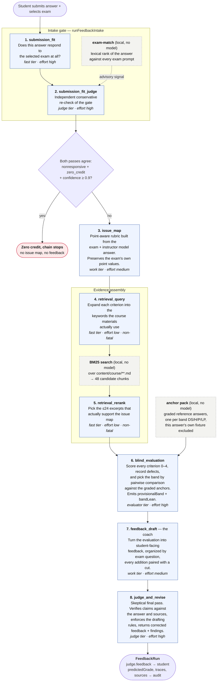
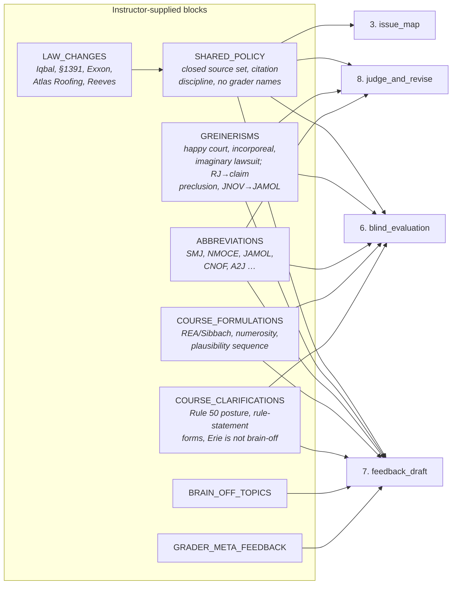
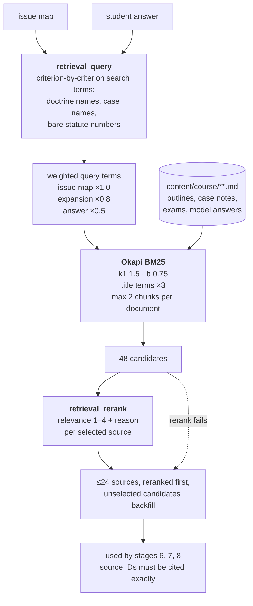
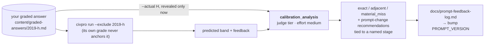

# The student-feedback prompt chain

Prompt version `civpro-feedback-v4.26.0` · source of truth: `src/stages.ts` (wiring), `src/prompts.ts` (text), `src/types.ts` (schemas)

Model tiers (set in `.env`): **fast** and **work** default to `claude-sonnet-5`; **evaluator** and **judge** default to `claude-opus-5-5`. Every call uses adaptive thinking at the stated effort.

Every box below is one model call made through `runStage()` in `src/chain.ts`. Each call is a
structured-output call: a developer/system prompt, one user message, and a Zod schema the
model must fill. No stage sees a later stage's output, and no stage sees the student's real
grade.

---

## 1. The live chain, end to end

---

## 2. What each stage is given and what it returns

| # | Stage | Developer prompt | User-message inputs | Schema out | Model · effort |
|---|-------|------------------|---------------------|-----------|----------------|
| 1 | `submission_fit` | `submissionFitDeveloperPrompt` | exam prompt, student answer | `SubmissionFitAssessmentSchema` | fast · high |
| 2 | `submission_fit_judge` | `submissionFitJudgeDeveloperPrompt` | exam, answer, first-pass result, local exam-match ranking | `SubmissionFitJudgeSchema` | judge · high |
| 3 | `issue_map` | `rubricDeveloperPrompt` | exam, instructor model answer | `IssueMapSchema` | work · medium |
| 4 | `retrieval_query` | `queryExpansionDeveloperPrompt` | issue map, answer | `RetrievalQuerySchema` | fast · low |
| 5 | `retrieval_rerank` | `sourceRerankDeveloperPrompt` | issue map, answer, 48 BM25 candidates | `SourceRerankSchema` | fast · low |
| 6 | `blind_evaluation` | `evaluationDeveloperPrompt` | exam, model answer, issue map, answer, **anchor pack**, ≤24 sources | `EvaluationSchema` | evaluator · high |
| 7 | `feedback_draft` | `coachDeveloperPrompt` | answer, issue map, evaluation, sources | `FeedbackSchema` | work · medium |
| 8 | `judge_and_revise` | `judgeDeveloperPrompt` | exam, model answer, answer, issue map, evaluation, **draft feedback**, sources | `JudgeSchema` | judge · high |

Note what stage 7 does *not* receive: the exam prompt, the model answer, and the anchors.
The coach works from the evaluation's findings, so the band comparison cannot leak into the
student-facing prose. Stage 8 gets everything back so it can check the coach against the record.

---

## 3. Shared prompt blocks — who gets what

The instructor-supplied material lives in `src/prompts.ts` as named constants that are
interpolated into several developer prompts. This is the injection matrix:

Stages 1, 2, 4 and 5 carry none of it — the gate and the retrieval stages have no business
grading, so they are kept deliberately thin.

---

## 4. Retrieval, in detail

There is no embeddings endpoint in the Claude API, so the "semantic" half of retrieval is
stage 4: Claude names the vocabulary the course materials would use, and BM25 matches it
lexically. If stage 4 or 5 fails, the run continues on raw BM25 order rather than aborting.

---

## 5. The calibration loop (optional)

Only meaningful when you know an answer's real band. The blind chain runs first; only then
is the actual band revealed to a separate analyst stage.

## 6. Reliability behavior

- Streamed calls, `max_tokens` 32000, adaptive thinking, per-stage effort.
- The SDK retries 429/5xx itself; each stage then retries once more after 5s + jitter.
- 400/401/403/404 and refusals are not retried.
- `retrieval_query` and `retrieval_rerank` are optional: if they fail the run continues on plain
  BM25 order and is labeled `lexical_fallback` in `audit.md`.
- Every stage's output is a JSON file in the run folder, so an interrupted run resumes where it stopped
  (`civpro run --out <folder>`).
