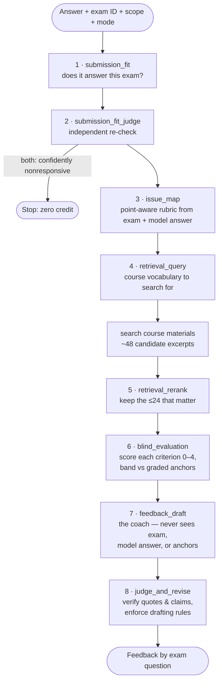

# CivPro Practice: context pack

Course-grounded feedback on Civil Procedure practice exams, for Professor Jim Greiner's HLS
Civil Procedure course. This is the prompt chain from the hosted CivPro Practice app, unbundled
into a **context pack** (the course materials) and **instructions** (the prompt chain as a
runbook). Load both into a desktop AI app, paste in a practice answer, and take as many cracks at
as many exams as you like. No code, no server, and no five-attempt cap.

> Formative practice only. The feedback is generated by a language model. It was tuned against
> real graded answers and reviewed by people who know the course, but it is not your professor
> and not a grade.

## What's in `pack/`

| File | Contents |
|---|---|
| [`00-INSTRUCTIONS.md`](pack/00-INSTRUCTIONS.md) | **The runbook.** How the model takes an answer through the chain and presents the feedback |
| [`01-chain.md`](pack/01-chain.md) | The eight stages: each one's inputs, **verbatim system prompt**, and required output fields |
| [`02-course-conventions.md`](pack/02-course-conventions.md) | Instructor-supplied conventions the prompts insert: Greinerisms, abbreviations, law changes since older materials, brain-off topics, clarifications |
| [`03-exam-index.md`](pack/03-exam-index.md) | All 19 finals (2007–2025) and 58 assignments, by ID |
| `10`–`13` | Exams with Greiner's model answers; assignments with circulated exemplary answers |
| `20`–`23` | Casebook, class summaries, review sessions, slides, primers, rules and statutes |

Twelve files, about 5 MB. Most apps search a pack this size rather than reading it all at once;
that's expected.

## Run it in a desktop app

### Claude (desktop app or claude.ai): a Project

1. Download this repo (**Code → Download ZIP**) and unzip it.
2. In Claude, create a **Project**, e.g. "CivPro feedback".
3. Paste the contents of `pack/00-INSTRUCTIONS.md` into the project's **instructions**. If the field
   is too short, paste just *"Follow 00-INSTRUCTIONS.md in the project knowledge exactly for every
   answer I share."*
4. Add **every file in `pack/`** to the project's knowledge, `00-INSTRUCTIONS.md` included.
5. Start a chat in the project. Pick the strongest model you have and turn on extended thinking.
6. Paste your answer and say which exam it's for:
   *"Here's my answer to Question 2 of the 2019 final, bullet points: …"*

### Claude desktop with a folder (Cowork / Claude Code)

Clone or unzip the repo, open the folder, and say:

> Follow `pack/00-INSTRUCTIONS.md` to give me feedback on `my-answer.md`, the 2019 final, whole exam.

With folder access, Claude runs each stage as its own sub-task and saves the stage outputs
under `runs/`. In Claude Code, `/feedback my-answer.md 2019-final` does the same thing.

### ChatGPT, Gemini, and others

Any app with custom instructions and file uploads works the same way: `00-INSTRUCTIONS.md` as
the instructions, the `pack/` files as knowledge. If your plan limits how many files you can
upload, keep files `00`–`03`, the exam file for your year (`10` or `11`), and as many of
`20`–`23` as fit. The prompts were tuned on Claude, so other models will differ.

## How the chain works

The stages are deliberately blind to one another, and to any real grade. The band
(DS/H/P/LP) is an internal calibration signal and never appears in the student's feedback.
Almost every rule in the prompts traces back to something a human reviewer flagged. The full
history is in [`docs/prompt-feedback-log.md`](docs/prompt-feedback-log.md).

## Optional: graded answers as band anchors

The hosted app ranked each answer against real graded finals, one per band. Those are other
students' work and are **not** included. The chain runs without them; the band is then simply
unanchored. To add your own, see [`content/graded-answers/README.md`](content/graded-answers/README.md),
which also explains where HLS students can find posted answers.

## Remixing

- **Prompts:** edit `pack/01-chain.md` and `pack/02-course-conventions.md` directly. They are
  the source of truth now. Bump the prompt version at the top of `01-chain.md` when you change
  behavior, and read [`docs/QA.md`](docs/QA.md) before deleting a rule.
- **Content:** the individual source files live in [`content/`](content/README.md). After adding
  or editing one (say, a new year's exam and model answer), rebuild the bundles with
  `python3 tools/build-pack.py`.

## License

Instructions and tooling: MIT. Course materials remain the property of their authors and are
shared for study use.
